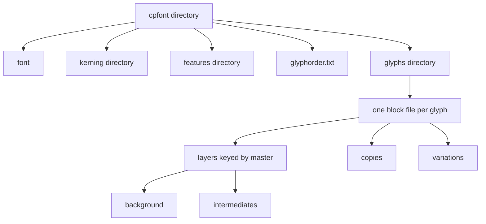

# Readable font package

## Status

Design record. Not scheduled. No loader or Babelfont converter is part of this note.

A directory format, working name `.cpfont`, holding the same information as a Babelfont font. Every file is the same indented block format: Python’s indent rule, a colon after each key, and tokens separated by spaces. Feature source sits in a `code` block inside that format. A loader rebuilds Babelfont JSON in one linear pass: parse each file, expand path lines into nodes, flatten the layer tree, swap master slugs for ids.

## Why this shape

Babelfont’s in-memory model (`[babelfont-rs/babelfont/src/font.rs](../../babelfont-rs/babelfont/src/font.rs)`, `[glyph.rs](../../babelfont-rs/babelfont/src/glyph.rs)`, `[layer.rs](../../babelfont-rs/babelfont/src/layer.rs)`) is one document: a flat `layers` array, backgrounds as sibling layers linked by `background_layer_id`, kerning pairs on each master, and nodes as `{"x","y","nodetype"}` objects. Counterpunch already projects that into main layers, attached backgrounds, and separate layer copies (`[Glyph.layers` in `editor/webapp/js/babelfont-model.ts](../webapp/js/babelfont-model.ts)`).

Splitting files is what makes GitHub usable. The block spelling is what makes a point move a one-token diff: indent shows nesting, the schema tells a map from a list, and a path line has no comma for the previous line to rewrite. The parse tree of each file is the Babelfont JSON this structure implies. Every `format_specific` value is a JSON value, and the object appended to a node is JSON. Nothing else in the package is JSON. The bag has no schema, so a bare token cannot be turned back into a string, number, bool, null, object, or array.




## Package

```text
Family.cpfont/
  font
  glyphorder.txt
  glyphs/
    contents
    A_.glyph
    a.glyph
    f_f_l.glyph
  data/                       # bulky blobs: images, hint programs
  kerning/
    groups
    regular
    bold
    rtl/regular                 # only when RTL pairs exist
  features/
    features                    # include paths and Features.format_specific
    classes/UPPERCASE
    prefixes/languagesystems
    liga
  variation-sequences           # only when UVS pairs exist
```

- `font` is identity, names, axes, cross-axis mappings, masters, instances, master metrics, and master guides. It contains neither glyphs, nor kerning pairs, nor feature source.
- `glyphs/contents` maps each glyph name to its filename. That map is the glyph set. `glyphorder.txt` is one glyph name per line and is only the order. Names present in `contents` and absent from the order are appended in filename order. The order may also name glyphs that have no file. Reordering glyphs does not rewrite glyph files. A writer keeps an existing filename instead of inventing a new one.
- The package contains plain files and directories only. Symlinks are not allowed.
- Kerning is outside `font`. Groups are separate from pair values so a spacing change does not sit in the membership lists. One pair file per master keeps two people kerning different masters from colliding. RTL pairs, stored in Babelfont under `Font.format_specific`, are first-class here. Kerning files have no `format_specific` of their own.
- Each class, prefix, and feature is one block file. Its `code` value is the AFDKO text. `features/features` is Babelfont’s `Features` object: include paths and that object’s bag.
- Unicode variation sequences get their own file because CJK UVS lists are large and rarely edited with outlines. The map has no `format_specific`.
- `data/` holds bulky files that would swamp a glyph diff: PNG images and TrueType or hint programs. A `format_specific` value may name a file there. Image color stays in the bag and is applied when the image is read. The stored PNG is unchanged.
- Omitted files mean empty. Empty background, copy, intermediate, and variation keys are omitted too.
- Keys this format defines for itself use a `public.` prefix. Keys from other tools stay reverse-domain names inside `format_specific`.

Machine-local data stays out of the package: Babelfont `source`, and a save timestamp. Version is the explicit `version` field only.

## Names, not UUIDs

Masters, instances, and axes are referred to by a short slug (`regular`, `bold`, `wght`) defined once in `font`. Display names live only there. Renaming “Regular” to “Roman” does not touch glyph or kerning files. Changing a slug is a deliberate repo-wide rename.

CRDT ids on glyphs, layers, paths, nodes, anchors, and components are not source. A Babelfont session can mint them on load. Writing them into the package would dominate every diff.

`format_specific` stays what it is in `.babelfont`: one bag on the object it belongs to, written after that object’s own fields. See below. A few structures are promoted out of the bag so they are not stored twice: feature-variation rules, RTL kerning, kern-group membership, and metrics keys (`left`, `right`).

## Glyph file

One `.glyph` file per glyph. The filename is the UFO user-name-to-file-name encoding of the glyph name, so `A` and `a` stay distinct on a case-insensitive filesystem such as GitHub’s. `glyphs/contents` is the authority:

```text
A: A_.glyph
a: a.glyph
f_f_i: f_f_i.glyph
.notdef: _notdef.glyph
```

The `name` inside the glyph file must match the `contents` key. On read, the map wins.

The encoding, applied before the `.glyph` suffix:

- Insert `_` after every character that is not a lowercase letter. `A` becomes `A_`, `A.alt` becomes `A_.alt`, and an underscore already in the name doubles, so `F_F_I` becomes `F__F__I_`.
- Replace a filesystem-illegal character with `_`: `" * + / : < > ? [ \ ] |` and the ASCII control range. A leading `.` becomes `_` when it would start the filename.
- Prefix a Windows reserved name (`CON`, `PRN`, `AUX`, `NUL`, `COM1`–`COM9`, `LPT1`–`LPT9`, `CLOCK$`) with `_`.
- Keep the result within 255 characters, including `.glyph`. If it still collides with another filename under case-insensitive comparison, append a 15-digit number, starting at `000000000000001`.

The file is schema-directed. Indentation is the only nesting. A colon marks a key. The parser knows, at each block, whether it is reading a map, a list, or a scalar. Braces and quotes appear only inside a `format_specific` JSON object.

Main layers are the master layers the Layers panel shows, keyed by master slug in master order. A background is nested on the layer it belongs to. Intermediates (brace layers: associated with that master and carrying a location) sit on that master, in axis order, because the panel groups them there. Layer copies (associated with a master, no location, not compiled) are a separate list. Feature-variation families are a third list so they stay distinct from copies.

```text
name: A
unicode: 0041
category: Letter
format_specific: {"color":3,"note":"alternate"}

layers:
  regular:
    width: 600
    shapes:
      path: l 80 0 cs 120 40 {"com.schriftgestalt.Glyphs.userData":{"label":"entry"}} l 520 0 l 520 700 l 80 700
        format_specific: {"fip001-boolean":"subtraction"}
      glyph: acute 300 700
        format_specific: {"com.schriftgestalt.Glyphs.alignment":-1}
    anchors:
      top: 300 700
        format_specific: {"com.schriftgestalt.Glyphs.anchorLocked":true}
    guides:
      xheight: 0 500
        angle: 0
        format_specific: {"com.schriftgestalt.Glyphs.userData":{"label":"x-height"}}
    background:
      path: l 90 0 l 510 0 l 510 690 l 90 690
      format_specific: {"com.schriftgestalt.Glyphs.userData":{"role":"sketch"}}
    intermediates:
      wght: 450
        width: 640
        path: l 70 0 l 560 0 l 560 700 l 70 700
        format_specific: {"com.schriftgestalt.Glyphs.colorLabel":1}
    format_specific: {"com.schriftgestalt.Glyphs.colorLabel":3}
  bold:
    width: 680
    format_specific: {"com.schriftgestalt.Glyphs.colorLabel":4}

copies:
  master: regular
    name: sketch
    width: 600
    format_specific: {"com.schriftgestalt.Glyphs.userData":{"role":"copy"}}

variations:
  wght: min 700
    regular:
      width: 600
      format_specific: {"com.schriftgestalt.Glyphs.colorLabel":2}
```

Glyph-level fields, matching Babelfont’s `Glyph`: `name`, `production`, `unicode` (hex strings, space-separated on one line), `category`, `exported` (omit when true), `direction`, smart-component `axes`, metrics keys (`left`, `right`), `format_specific`.

A layer holds `width`, `shapes`, `anchors`, `guides`, optional `color`, optional color-font `layerIndex`, optional metrics-key overrides, and `format_specific`. Backgrounds hold `shapes` only. Anchors, guides, and advance stay on the foreground; the editor already treats them that way.

A missing master key means that master has no layer. An empty layer is a present key with no outlines.

### Grammar

- A line is an indent plus a key. Indent is two spaces. Tabs are invalid.
- A key runs to the first `:`. That lets a kerning pair contain a space (`A T: -30`). `key: value` is a scalar; the value is the rest of the line. `key:` with a deeper following line opens a block. A list of strings is the exception: each child line is one string and has no colon. The value of `format_specific` is not a block. It is one JSON object, parsed with `JSON.parse`, so a key inside the bag may contain spaces and colons.
- A path’s nodes are groups on the `path:` line. A group is a type token (`c`, `cs`, `l`, `ls`, `q`, `qs`, `m`, `ms`, `o`), then x and y, then an optional JSON object that is that node’s `format_specific`. The path stays one line.
- Blank lines are ignored. They never separate values. `#` starts a comment through end of line.
- In a map (`layers`, a master layer, `location`), each key appears once.
- In a list, a line at the item indent starts an element. Lines indented under it belong to that element, until the next line at that indent or shallower. Head keys are `path` and `glyph` inside `shapes`, `master` inside `copies`, an axis tag or `location` inside `intermediates`, and an axis tag inside `variations`.
- A single-axis intermediate is `wght: 450` with the layer body indented under it. Several axes use `location:` and put only axis keys in that map; `width` and `shapes` stay siblings of `location`, indented one level under the element head.
- The rest of a string line is one string (`name: f_f_l`, `category: Letter`). `unicode` and coordinate-like fields split on spaces. Known numeric fields coerce. There is no untyped guessing: a glyph named `no` stays the string `no`.
- Quotes appear only when a value is empty or has leading or trailing spaces. They also appear inside a `format_specific` JSON object, where every string is quoted.

A key may carry both an inline value and a body. `glyph: acute 300 700` is the component; a deeper `rotate:` or `scale:` adds a non-identity transform. `path: open l 0 0 l 100 0` is an open path. `path: l 80 0 l 520 0` is closed. A path’s bag is a `format_specific:` line whose value is one JSON object. A node’s bag is the JSON object at the end of that node group.

### Shapes stay in one ordered list

Paths and components share Babelfont’s `shapes` order. Two separate lists would lose z-order. Each path is one line, the same way a `.babelfont` path stores its `nodes` array on one line. A contour is one visual unit, and a coordinate edit is one token inside that line.

```text
shapes:
  path: l 80 0 cs 120 40 {"com.schriftgestalt.Glyphs.userData":{"label":"entry"}} l 520 0 l 520 700 l 80 700
    format_specific: {"fip001-boolean":"subtraction"}
  glyph: acute 300 700
    rotate: 15
    format_specific: {"com.schriftgestalt.Glyphs.alignment":-1,"com.schriftgestalt.Glyphs.componentLocked":true}
  path: open m 0 0 l 100 0
```

`rotate` and `skew` are degrees, counter-clockwise. `scale` is two numbers. A variable component adds `location:` keyed by axis name. Identity transforms are omitted. The human spelling stays this decomposed transform.

Anchors and guides are one key per line: `top: 300 700`. An anchor named `caret_` contributes its x as a ligature caret and ignores y. An anchor named `vcaret_` contributes its y and ignores x. A ligature of N components has N−1 caret anchors. The text after the prefix is free (`caret_1`). A guide’s `angle` is degrees counter-clockwise from the horizontal, in the range 0–360. Omitting `angle` means a horizontal guide when only y is set, and a vertical guide when only x is set. A guide that needs an angle, a color, or a bag opens a block:

```text
guides:
  xheight: 0 500
    angle: 0
    format_specific: {"com.schriftgestalt.Glyphs.userData":{"label":"x-height"}}
```

### Node groups

The group is a direct spelling of a Babelfont node, not SVG path syntax. Conversion does not rebuild curve topology.

```text
m  x y      move
ms x y      smooth move
l  x y      line
ls x y      smooth line
o  x y      off-curve
c  x y      curve
cs x y      smooth curve
q  x y      quadratic
qs x y      smooth quadratic
```

Smooth is an `s` on the type token (`cs 120 40`). Babelfont stores that as `"nodetype": "Curve"` plus `"smooth": true`. An off-curve has no smooth form. Groups are separated by spaces on the path line. GitHub’s within-line highlight marks the group that changed. The whole path line is the line-diff.

On a Babelfont node, `format_specific` is the last field of the node object, omitted when empty (`Node` in `[babelfont-rs/babelfont/src/common/node.rs](../../babelfont-rs/babelfont/src/common/node.rs)`). In a one-line `nodes` array it sits at the end of that node:

```json
{"x":0,"y":0,"nodetype":"Curve","smooth":true,"format_specific":{"com.schriftgestalt.Glyphs.userData":{"label":"entry"}}}
```

Glyphs node `userData` is copied into that bag under `com.schriftgestalt.Glyphs.userData`. UFO point lib is stashed the same way. There is no separate node-name field.

The path line puts the same bag after the coordinates. A `{...}` JSON object is the node’s `format_specific` and nothing else. Compact JSON, keys sorted. The scanner reads one JSON value, so nested braces and quotes stay inside the bag. The next node type follows it.

```text
path: l 80 0 cs 120 40 {"com.schriftgestalt.Glyphs.userData":{"label":"entry"}} l 520 700 l 80 700
```

### format_specific

Thirteen Babelfont types have the field. The bag is the last key on that object, omitted when empty. Its value is one compact JSON object, not a nested block. `JSON.parse` of that object is the whole resurrection: strings stay strings, numbers stay numbers, and a key such as `Variable Font Origin` stays inside the JSON. Keys inside the object are sorted. Samples often keep an empty `com.schriftgestalt.Glyphs.attr`; this format does not.

```text
format_specific: {"color":3,"com.schriftgestalt.Glyphs.anchorLocked":true,"com.schriftgestalt.Glyphs.customParameters.Variable Font Origin":{"disabled":false,"value":"m005"},"note":"alternate"}
```

Promoted out of the bag, so they are not stored twice: feature-variation rules, RTL kerning, kern-group membership (including glyph `kern_left` / `kern_right` / `kern_top` / `kern_bottom`), and the left/right metrics keys.

- `Font` (`[font.rs](../../babelfont-rs/babelfont/src/font.rs)`). Glyphs app version, display strings, number names, custom parameters, userData. RTL kerning is promoted to `kerning/rtl/`.
- `Axis` (`[axis.rs](../../babelfont-rs/babelfont/src/axis.rs)`). The field is on the struct. Glyphs import leaves it empty, so a writer omits it until something is stored.
- `Master` (`[master.rs](../../babelfont-rs/babelfont/src/master.rs)`). `iconName`, `visible`, stem values, number values, userData. Designspace stashes the style name here.
- `Instance` (`[instance.rs](../../babelfont-rs/babelfont/src/instance.rs)`). `weightClass`, `widthClass`, `exports`, `isBold`, `isItalic`, userData, custom parameters.
- `Glyph` (`[glyph.rs](../../babelfont-rs/babelfont/src/glyph.rs)`). Short keys from Glyphs: `color`, `note`, `script`, `subcategory`, `locked`, `tags`, plus userData. `metric_left` / `metric_right` are the `left` / `right` fields instead.
- `Layer` (`[layer.rs](../../babelfont-rs/babelfont/src/layer.rs)`). `colorLabel`, `attr`, hints, annotations, background image, vertical metrics, userData. Every layer in the file is this type: master, intermediate, copy, variation, and the nested background.
- `Path` (`[shape.rs](../../babelfont-rs/babelfont/src/shape.rs)`). `fip001-boolean`, `attr`. Indented under the path line.
- `Component` (`[shape.rs](../../babelfont-rs/babelfont/src/shape.rs)`). `alignment`, `componentAnchor`, `componentLocked`, `attr`. Indented under the `glyph:` line.
- `Node` (`[node.rs](../../babelfont-rs/babelfont/src/common/node.rs)`). Glyphs node `userData`, UFO point lib. The JSON object at the end of that node group, not an indented block.
- `Anchor` (`[anchor.rs](../../babelfont-rs/babelfont/src/anchor.rs)`). `anchorLocked`, `anchorOrientation`, UFO lib.
- `Guide` (`[guide.rs](../../babelfont-rs/babelfont/src/guide.rs)`). userData, on a master guide and on a layer guide.
- `Features` (`[features.rs](../../babelfont-rs/babelfont/src/features.rs)`). Fontra `customData`, copied through under its original keys. File: `features/features`.
- `PossiblyAutomaticCode` (`[features.rs](../../babelfont-rs/babelfont/src/features.rs)`). On each class, prefix, and feature: `com.schriftgestalt.Glyphs.disabled`, `notes`, and `labels`.

## Kerning files

`kerning/groups` is the only place group membership lives. Pair-side names are `left` and `right` (the first and second sides of a pair). Those map onto Babelfont `first_kern_groups` and `second_kern_groups`. Members are one glyph name per line, sorted by glyph name, so a glyphorder edit does not rewrite groups. Glyph-level `kern_left` / `kern_right` hints are not copied onto the glyph file.

A glyph may belong to several groups on the same side. Membership is the list under each group, and the same name may appear under more than one group on `left`, and more than one group on `right`.

A pair whose value is zero is omitted. The exception is a zero that overrides a group pair: that zero is written, because an absent pair means “no kerning” and would otherwise fall through to the group.

Lookup for a glyph pair, first hit wins:

1. The glyph+glyph pair.
2. A glyph+group pair. If several of the second glyph’s groups have a pair, the group that appears first in `kerning/groups` wins.
3. A group+glyph pair, with the same first-listed-group rule.
4. A group+group pair, walking first-side groups in file order and, within each, second-side groups in file order.

A glyph+group pair wins over a group+glyph pair when both exist. `kerning/rtl/` uses the same rules.

```text
left:
  A:
    A
    Aacute
    Agrave
  A.wide:
    A
    AE
right:
  T:
    T
    Tcedilla
```

`A` is in both `A` and `A.wide` on the left. That is allowed.

`kerning/regular` is one pair per line, sorted by left, then right. The key is the pair, so it may contain a space; the value is the integer. A group reference is `@name`.

```text
@A @T: -40
@A o: -20
A T: -30
A V: -50
```

Moving one pair’s value is a one-line diff. `kerning/rtl/regular` uses the same spelling.

## Variation sequences

`variation-sequences` maps a base scalar and a variation selector, in hex, to a glyph name.

```text
0041 FE00: uni0041.ss01
0041 FE01: uni0041.ss02
```

## Font file

`font` lists metrics and guides on each master. Kerning lives under `kerning/`. `Axis.format_specific` is shown because the field is on the struct; Glyphs import leaves it empty and a writer then omits the block.

```text
format: 1
upm: 1000
version: 1 0
names:
  family:
    dflt: Family
axes:
  wght:
    name:
      dflt: Weight
    min: 400
    max: 700
    default: 400
    format_specific: {"com.schriftgestalt.Glyphs.userData":{"note":"weight axis"}}
masters:
  regular:
    name:
      dflt: Regular
    location:
      wght: 400
    metrics:
      ascender: 800
      descender: -200
      xHeight: 500
    guides:
      baseline: 0 0
        angle: 0
        format_specific: {"com.schriftgestalt.Glyphs.userData":{"label":"baseline"}}
    format_specific: {"com.schriftgestalt.Glyphs.iconName":"Regular","com.schriftgestalt.Glyphs.visible":false}
instances:
  regular:
    name:
      dflt: Regular
    location:
      wght: 400
    format_specific: {"com.schriftgestalt.Glyphs.weightClass":400,"com.schriftgestalt.Glyphs.widthClass":5}
format_specific: {"com.schriftgestalt.Glyphs.appVersion":"3401","com.schriftgestalt.Glyphs.customParameters.hheaAscender":{"disabled":false,"value":800}}
```

Localized strings keep Babelfont’s `dflt` key so name conversion is a copy. Axis tags stay the four-character OpenType tags.

## Feature files

`features/features` is the `Features` object. Include paths are a string list. The bag is Fontra `customData`: each key is copied through unchanged.

```text
include:
  includes/local.fea
format_specific: {"note":"kept from Fontra"}
```

A class, prefix, or feature file is one `PossiblyAutomaticCode`. `code` is the AFDKO source. A multiline `code` value is the indented block, and the writer strips that indent. `automatic` is omitted when false.

`features/classes/UPPERCASE`:

```text
code: A B C D
format_specific: {"com.schriftgestalt.Glyphs.disabled":true,"com.schriftgestalt.Glyphs.notes":"capitals"}
```

`features/liga`:

```text
code:
  sub f i by f_i;
format_specific: {"com.schriftgestalt.Glyphs.disabled":true,"com.schriftgestalt.Glyphs.labels":[{"language":"dflt","value":"Standard Ligatures"}],"com.schriftgestalt.Glyphs.notes":"old liga"}
```

## Canonical bytes

Two writers must emit the same bytes for the same font. That is the diff rule.

Shared:

- UTF-8, LF, two-space indent, one trailing newline, no tabs, no trailing spaces.
- Fixed key order, documented per object.
- Omit default and empty values: `exported` when true, identity transforms, empty `format_specific`, empty backgrounds, `.0` on integral numbers.
- Shortest round-trip decimal for fractional numbers. `100` stays `100`.
- Layer keys follow master order. Intermediates follow axis order. Copies follow master slug, then name. Kern pairs and group members follow the sorts above.
- The source file is the numeric authority. Degrees convert to Babelfont radians on the way in; the way out quantizes back to the stored degree value, so a load/save does not dirty `rotate`.

Glyph files also:

- One blank line between top-level sections (`layers`, `copies`, `variations`, `format_specific`). No blank lines inside a section.
- Top-level order: `name`, `production`, `unicode`, `category`, `exported`, `direction`, `axes`, `left`, `right`, `layers`, `copies`, `variations`, `format_specific`.
- Layer order: `width`, `left`, `right`, `shapes`, `anchors`, `guides`, `color`, `layerIndex`, `background`, `intermediates`, `format_specific`.
- On every object, `format_specific` is the last key. Its JSON object’s keys are sorted by string.

Every `format_specific` value is one canonical compact JSON object on the same line: strings quoted, keys sorted, no extra spaces. A node’s trailing object follows the same JSON rules.

## What a loader does, and nothing more

1. Parse every block file with an indent stack. Read `glyphs/contents` as the glyph-name-to-filename map and `glyphorder.txt` as lines. `JSON.parse` the whole `format_specific` object and every node suffix. A type token ending in `s` (`cs`, `ls`, `qs`, `ms`) sets `smooth`.
2. Build Babelfont masters, axes, instances, names, and features from `font` and `features/`.
3. Split each path line into nodes `{x, y, nodetype, smooth}`. A `{...}` after a node is that node’s `format_specific`. Expand each `path` / `glyph` entry into a path or component. Convert degrees to radians. `JSON.parse` each `format_specific` object onto that Babelfont object.
4. Flatten the glyph hierarchy into `layers[]`: master layer as `DefaultForMaster`, each intermediate and each copy as `AssociatedWithMaster`, each variation layer the same plus axis rules. Mint a background sibling only when `background` is present, and link the pair.
5. Expand kerning lines into each master’s `"left:right" → value` map, and groups into `first_kern_groups` / `second_kern_groups`.
6. Mint fresh ids if the session wants them.

The reverse writer is the same steps inverted, then the canonical serializer. Mapping to UFO, Glyphs, or designspace is out of scope.

## Left out on purpose

- One file per layer, and UFO’s font-wide layer directories. Each glyph is one file, and a background stays nested on its foreground.
- UFO’s rule that a glyph may belong to only one kerning group per side. Several groups on the same side are allowed.
- JSON files. The package is the block format. JSON text appears only as a `format_specific` value or a node’s trailing bag.
- List dashes and YAML typing.
- CRDT ids, plist/XML, and a single-file Babelfont document as the source of truth.
- A loader. The mapping above is the contract for that later work, which is not scheduled.

